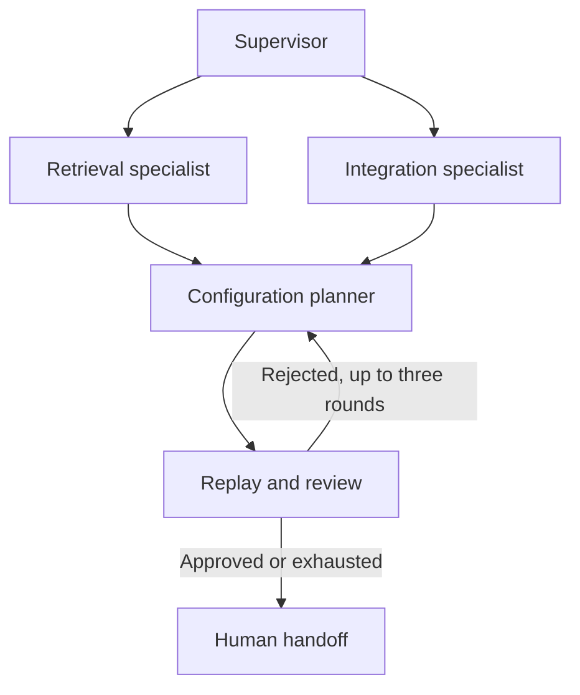

# FieldOps

**Diagnose a broken customer AI deployment, propose a bounded repair, and replay the acceptance suite before recommending rollout.**

A forward deployed engineering prototype built around a synthetic retailer. Its support assistant mixes customer policies, retrieves stale documents, and fails when the ERP service is slow or returns transient errors.

## Try it in 30 seconds

Python 3.10+ recommended. The offline sandbox uses only the standard library:

```bash
git clone https://github.com/abedmhaissen/fieldops.git
cd fieldops
python main.py
python -m unittest discover -v
```

`report.json` records the baseline, the rejected first repair, the accepted configuration, and per-case outcomes. See [example-report.json](example-report.json) for checked-in output.

| Synthetic acceptance metric | Before | After |
|---|---:|---:|
| Correct scenarios | 1/6 | 6/6 |
| Tenant isolation | 4/6 | 6/6 |
| Successful API scenarios | 3/6 | 6/6 |
| Simulated p95 | 100 ms | 520 ms |

The baseline fails fast: a lower latency is meaningless if requests fail. The accepted repair stays below the customer's 700 ms budget. These are six engineered acceptance cases, **not production benchmarks or held-out generalization results**.

## Agent architecture



`agents.py` implements an actual LangGraph state machine. The supervisor invokes role-specific LangChain ReAct agents with inspection and sandbox evaluation tools. Specialists currently execute sequentially. A structured planner proposes configuration; a deterministic reviewer sends failed candidates back with feedback. This is external, test-based self-reflection rather than hidden chain-of-thought logging.

Only four configuration fields may change. No shell, production credentials, arbitrary code execution, or live infrastructure mutations are exposed. Subagents have recursion limits; the outer repair loop stops after three proposals. Errors surface to the caller rather than being presented as success.

## Gemini mode

```bash
python -m venv .venv
source .venv/bin/activate
pip install -r requirements.txt
export GOOGLE_API_KEY='your-key'
export GEMINI_MODEL='your-available-gemini-model-id'
python main.py --live --output live-report.json
```

For Google Cloud authentication, configure Application Default Credentials, `GOOGLE_GENAI_USE_VERTEXAI=true`, `GOOGLE_CLOUD_PROJECT`, and `GOOGLE_CLOUD_LOCATION` using the [integration documentation](https://docs.langchain.com/oss/python/integrations/chat/google_generative_ai). The model ID is explicit because availability varies by account and region. API use can incur charges.

Live mode records specialist token counts, tool calls, elapsed time, and planner spans. It does not calculate dollar cost without a configured pricing table. The scripted offline mode never claims to run an LLM. [test_agents.py](test_agents.py) exercises real graph routing and specialist tools using a scripted chat model when dependencies are installed.

## Customer handoff

Discovery questions: Which tenants and roles share an index? Who owns policy freshness? What is the ERP timeout contract? What happens after retry exhaustion? What is the latency budget, and who can approve rollout?

Rollout proposal: customer platform team owns the change; replay a larger withheld dataset, shadow traffic, then canary to 5%. Block promotion on isolation failures or p95 above 700 ms. Roll back to the prior versioned configuration if errors rise. This repository produces a sandbox recommendation; it does not execute that rollout.

## Scope and next steps

This is a portfolio prototype, not a production incident response platform. Fault behavior and latency are modeled in Python. No real ERP integration, cloud deployment, durable checkpoints, authenticated API, distributed tracing backend, or measured customer ROI is included. Next work: HTTP fault injection, checkpoint persistence, a withheld incident suite, and a customer-operated Cloud Run service with IAM and monitoring.
